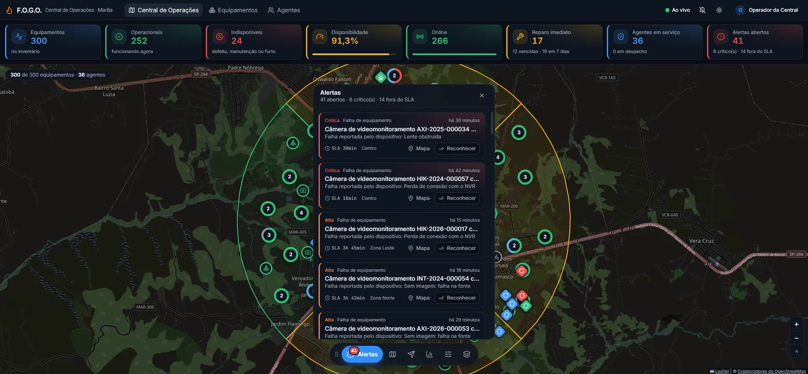
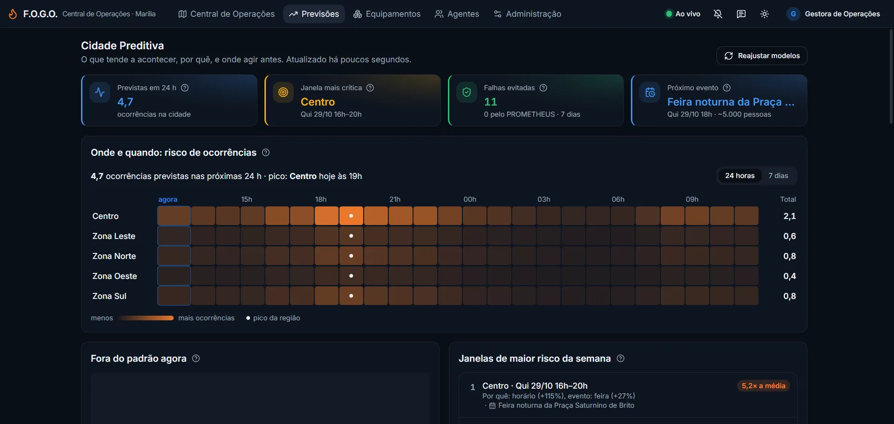
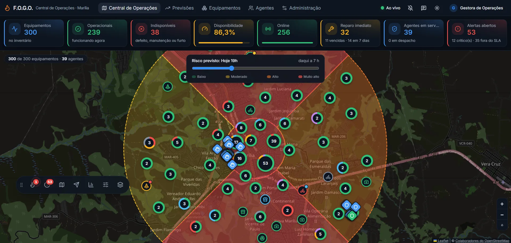
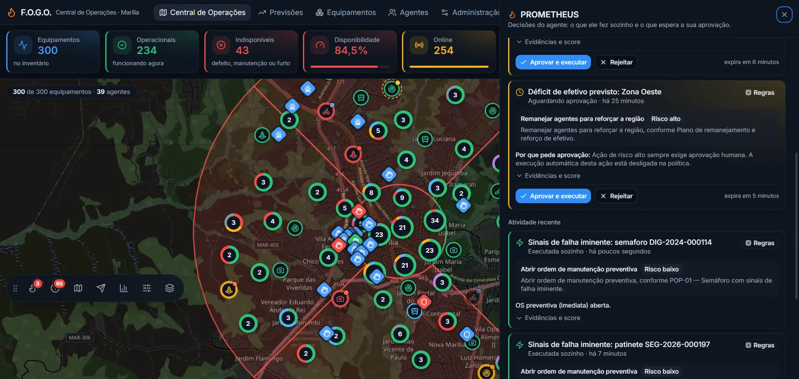
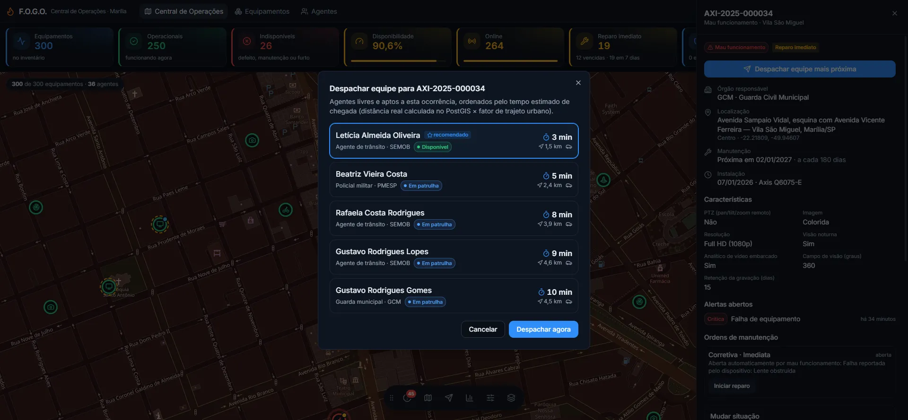
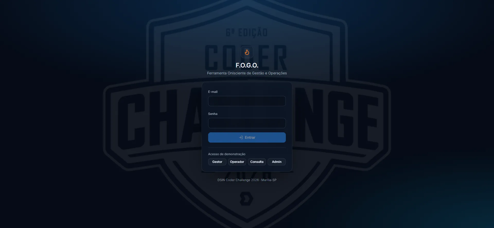

# F.O.G.O. — Ferramenta Onisciente de Gestão e Operações

Projeto da **Etapa Bônus do DSIN Coder Challenge 2026**, dividido nas três partes do enunciado:

| Parte | Escopo | Status |
|---|---|---|
| **1 — Inventário Inteligente da Cidade** | Cadastro de equipamentos IoT e agentes (API + telas) | ✅ |
| **2 — Central de Operações** | Mapa e painel em tempo real, alertas, regiões, despacho | ✅ |
| **3 — Cidade Preditiva** | Previsões explicáveis com backtest, agente **PROMETHEUS** (LangGraph + humano no circuito), RAG híbrido e IA do próprio usuário | ✅ |



📘 **[Manual do usuário](docs/manual.md)**: passo a passo de cada tela, com prints. No sistema, ele abre pelo ícone **?** da barra superior.

---

## Como rodar (de primeira)

Pré-requisito: **Docker** com Docker Compose.

```bash
cp .env.example .env
docker compose up --build
```

| O quê | Onde |
|---|---|
| **Central de Operações** (front) | **http://localhost:8080** |
| Swagger (API interativa) | http://localhost:8000/docs |
| Health check | http://localhost:8000/health/ready |

> A primeira subida leva cerca de **5 minutos**: o build baixa as dependências e o modelo de embeddings local (~0,2 GB, não fica no repositório); depois o serviço `migrate` aplica as migrations, gera os dados de demonstração **simulando um ano de operação de Marília-SP** e indexa a base de conhecimento. Em seguida sobem a API, o `scheduler` (jobs e previsões), o `simulator` (dispositivos IoT e GPS das equipes) e o `web`. Nas subidas seguintes, o seed é pulado.
>
> **Não é preciso chave de IA.** Previsões, busca na base e decisões do PROMETHEUS funcionam sem ela; a chave (opcional) é cadastrada na própria tela.

### Usuários de demonstração

Na tela de login há botões "entrar como". Todos usam a senha **`Fogo@2026`**.

| E-mail | Perfil | O que pode fazer |
|---|---|---|
| `admin@fogo.dev` | admin | tudo, inclusive usuários e a chave do modelo de IA |
| `gestor@fogo.dev` | gestor | cadastrar e editar equipamentos, agentes, órgãos e planos; política de autonomia e base de conhecimento; tudo do operador |
| `operador@fogo.dev` | operador | operar a Central: reconhecer alertas, despachar equipes, mudar situação, conduzir reparos e aprovar/rejeitar ações do PROMETHEUS |
| `consulta@fogo.dev` | consulta | somente leitura |

### Roteiro de 3 minutos para avaliar

1. Entre como **operador**. O selo **"Ao vivo"** confirma o fluxo de eventos, e os agentes em patrulha se movem no mapa.
2. Abra **Alertas** na barra flutuante sobre o mapa (o contador pulsa quando há crítico) e use **"Mapa"** num alerta crítico. O mapa voa até o equipamento e abre o painel de detalhes.
3. Clique em **"Despachar equipe mais próxima"**. As sugestões vêm do PostGIS (KNN), com ETA e cargo apto. Despache e veja a rota tracejada; a chegada é detectada pelo GPS (geofence).
4. No mesmo painel, **inicie e conclua o reparo**. O equipamento volta a operacional e o alerta se resolve sozinho.
5. Na barra flutuante, veja **Regiões** (índice de saúde com motivos), ative o **mapa de calor** e troque o **estilo do mapa** (claro, escuro, satélite) em **Camadas**, e clique nos **KPIs** para filtrar o mapa. A barra pode ser arrastada para qualquer ponto do mapa.
6. Entre como **gestor** e cadastre um equipamento em *Equipamentos → Novo*. O formulário é gerado pelo tipo, o CEP preenche o endereço e um clique no mapa marca a coordenada.

### Rodar os testes

```bash
docker compose up -d postgres
docker compose --profile test run --rm tests        # backend: ruff + mypy --strict + 302 testes

cd frontend && npm ci && npm test                   # front: 28 testes (Vitest) + `npm run typecheck` e `npm run lint`
```

---

## Parte 3 — Cidade Preditiva e PROMETHEUS

> *"Você consegue fazê-lo enxergar o que pode acontecer amanhã?"*

**Princípio:** as previsões são **estatísticas, explicáveis e testadas (backtest)**. Elas não vêm de um LLM. O agente **PROMETHEUS** (LangGraph) usa essas previsões e a base de conhecimento para agir sozinho quando a confiança medida é alta, e para **pedir aprovação humana** quando não é. **Tudo funciona sem chave de IA.** Com a chave do próprio usuário, o modelo de IA escolhe a ação e escreve a justificativa citando os procedimentos, e o chat "Pergunte ao PROMETHEUS" é liberado.



### O que é previsto, com quais dados, e como ajuda

Esta é a exigência explícita do enunciado. Cada cartão da tela **Previsões** mostra os três itens.

| Previsão | O que prevê | Dados usados | Como ajuda na decisão |
|---|---|---|---|
| **Risco por região × hora** (7 dias) | Quantas falhas, furtos e vandalismos de equipamentos devem ocorrer em cada região, hora a hora | 1 ano de histórico de situações, tempo de operação de cada equipamento, calendário público (feriados, jogos do MAC, shows, feiras) | Concentrar equipes e manutenção onde e quando o risco é maior. Mapa com **controle deslizante de horário** |
| **Onde posicionar o efetivo** | Agentes ideais por região em cada faixa de 4 h, contra os escalados | Risco previsto, efetivo em serviço e público de eventos (1 agente a cada 2.000 pessoas) | Remanejamentos concretos ("mover 3 de Oeste para Norte"), sempre com aprovação do gestor |
| **Equipamentos em risco (72 h)** | Probabilidade de falha de cada equipamento operacional | Taxa do tipo, tendência recente, região, **preventiva vencida** (efeito medido no histórico) e o perfil das próximas 72 h | Antecipar a preventiva de poucos equipamentos críticos (botão na própria tela) |
| **Fora do padrão agora** | Falha iminente (minutos) e picos regionais | Telemetria ao vivo contra a última hora do próprio equipamento (z robusto) e participação histórica das regiões (teste binomial) | Intervir antes da falha. **Precisão, cobertura e antecedência são medidas ao vivo** |
| **Tendência de disponibilidade** | Queda semana a semana e a data em que cruza 90% | Situação diária reconstruída do histórico (Theil–Sen) | Renovação de frota e cobrança de SLA antes de virar crise |



### O modelo é confiável? (backtest honesto)

O modelo é treinado **sem as últimas 8 semanas** e prevê essas semanas. Depois é comparado com duas linhas de base:
- **média histórica:** o modelo é melhor;
- **perfil por hora:** empate, dentro do ruído.

Nas 20% faixas que o modelo aponta como mais arriscadas acontecem **cerca de metade das ocorrências reais** (≈2,5× o acaso). A tela mostra a curva de calibração e os fatores aprendidos.

O modelo **redescobriu, sem ler os parâmetros da simulação**, os padrões injetados no seed:

| Padrão da cidade simulada | Real | Aprendido pelo modelo |
|---|---|---|
| Região Norte, a de maior risco | ×1,45 | a maior entre as regiões |
| Vandalismo nas noites de sexta e sábado (equipamentos em espaço público) | ×2,2 | ×1,6–1,8 |
| Shows (público de ~15 mil) | ≈×2,5 | ×2,0 |
| Feriado no trânsito (menos movimento) | ×0,8 | ×0,66 |
| Preventiva vencida | ×1,8 | ×1,6 |
| Envelhecimento da frota de patinetes | crescente | tendência ×1,2 |

> **Leitura crítica.** O horário do dia responde pela maior parte do volume de ocorrências. Os demais fatores são reais, mas refinam *onde* e *quando*: com 8 semanas de teste, o ganho deles sobre o "perfil por hora" fica dentro do ruído. Preferimos mostrar isso a vender uma precisão que os dados não sustentam.

### Aprendizado contínuo: menos alarmes falsos com o tempo (machine learning)

Cada aviso de "falha iminente" termina de três formas: **falhou**, **foi evitado** (era falha real) ou **alarme falso**. Esses desfechos são **rótulos reais que crescem com o uso**. Um classificador (regressão logística, em numpy) é **retreinado sozinho a cada desfecho novo** e estima, para cada novo aviso, a **probabilidade de ser falha real**. Essa probabilidade é a *confiança* que a política de autonomia usa.

- **Avaliação temporal:** treina nos desfechos mais antigos e testa nos mais recentes. A tela mostra a precisão do modelo contra a regra "todo alarme é falha".
- **O que ele aprende** (e mostra): perda de link (sinal e uptime) indica falha real; aquecimento sozinho costuma ser alarme falso (sol no invólucro).
- **Por que regressão logística e não XGBoost:** com dezenas a centenas de rótulos, um modelo simples e calibrado é mais estável, explicável e não traz dependências pesadas. No modelo de risco, o backtest já mostrou que mais parâmetros não ganham do perfil por hora com o volume de dados disponível.

### Guardrails (proteções)

| Onde | Proteção |
|---|---|
| **Documentos da base** (tela) | Recusa **injeção de prompt** ("ignore as instruções…"), **segredos** (chaves, tokens, senhas) e **dados pessoais** (CPF, telefone, e-mail). Exige seções (##) e limita a 20 mil caracteres. **Teto de autonomia: risco médio** (risco alto só por documento revisado no repositório). O editor mostra cada verificação e o que foi encontrado |
| **Documentos do repositório** | Mesma varredura no bootstrap; documento com injeção ou segredo não é indexado |
| **Chat** | Dados pessoais e segredos **mascarados antes de ir ao modelo**, com aviso. Recusa tentativas de mudar as regras. Assunto restrito à operação da cidade. **Só leitura** (não executa ações). A faixa "Proteções ativas" deixa isso claro |
| **Agente** | O LLM só escolhe entre ações autorizadas pelo procedimento; parâmetros vêm dos dados; trechos da base são tratados como dados, nunca como instruções; a decisão de agir sozinho é do código |

### PROMETHEUS: decide sozinho ou pergunta



```
retrieve (RAG híbrido) → plan (LLM ou regras) → validate → score ─┬─ executa sozinho
                                                                   └─ pede aprovação (interrupt) → humano aprova/rejeita → retoma
```

- **Situações que ele percebe:**
  - falha iminente (precursor na telemetria);
  - risco alto em 72 h;
  - pico regional fora do padrão;
  - déficit de efetivo previsto.
- **O que ele pode fazer:**
  - abrir OS preventiva (risco baixo);
  - emitir alerta preventivo (risco baixo);
  - despachar agente para inspeção (risco médio);
  - remanejar efetivo (risco alto, **sempre** com humano).
- **A regra de autonomia é do código, nunca do LLM:**
  - `score = confiança × evidência`;
  - **confiança** é uma probabilidade **medida**: a precisão das detecções ao vivo, 1 − p-valor ou a probabilidade do modelo;
  - **evidência** é a aderência do procedimento da base que autoriza a ação.
- **Quando age sozinho:** só se o modo for autônomo, o score atingir o limiar da ação, o procedimento permitir aquele nível de risco e o teto de execuções por hora não tiver estourado. Cada condição que falha vira um motivo legível no pedido de aprovação.
- **Rastreável:** cada decisão grava os dados, os trechos citados, o score, quem aprovou e o resultado. As ações aparecem no histórico assinadas pelo usuário de sistema **PROMETHEUS**.
- **Falhas evitadas:** se a equipe intervém antes da falha prevista, o simulador cancela a falha e o contador sobe. Na simulação isso é verdade de campo; numa cidade real seria uma estimativa.
- **Freios:** modo autônomo, só sugestão ou pausado; limiar e teto por ação (Administração → Autonomia); pedidos que expiram em 30 min.

### Base de conhecimento (RAG híbrido)

São 13 documentos **fictícios e plausíveis**: procedimentos (POPs), planos de contingência por região, SLA das concessionárias, protocolo de eventos, lições aprendidas e a política de autonomia. Os metadados de cada um dizem **quais ações autoriza** e com que **autonomia máxima**.

A busca combina três rankings, fundidos por **RRF**:
- **BM25** sobre os radicais em português;
- **embeddings locais** (modelo multilíngue embutido na imagem; funciona sem chave);
- opcionalmente, **embeddings do provedor** (OpenAI ou Gemini).

Em **Administração → Base de conhecimento** dá para testar a busca e ver a posição de cada documento em cada ranking.

### Modelo de IA do usuário (BYOK)

Em **Administração → Inteligência artificial** (só admin):
- **Provedores:** OpenAI, Anthropic, Gemini ou qualquer servidor **compatível com OpenAI** (Ollama, OpenRouter, Azure).
- **Chave:** **cifrada** no banco (Fernet) e **só de escrita**; a tela mostra apenas os 4 últimos caracteres.
- **Antes de salvar:** **testar conexão** com cerca de 20 tokens e **listar modelos** sem custo.
- **Controle de uso:** limites diários de chamadas e de tokens, disjuntor contra instabilidade, e consumo e custo estimado por dia.

### Roteiro de 3 minutos (Parte 3)

1. Entre como **gestor** e abra **Previsões**:
   - passe o mouse na matriz de risco para ver o motivo de cada horário, e use os ícones **(?)** para entender cada previsão e métrica;
   - veja onde reforçar o efetivo, os equipamentos em risco e o backtest.
2. Na **Central**, abra **Camadas → Risco previsto** e arraste o controle de horário: o mapa muda conforme as próximas 24 h.
3. Abra o **PROMETHEUS** (ícone da chama na barra flutuante), que abre num painel lateral:
   - em poucos minutos o simulador gera precursores de falha;
   - o PROMETHEUS **abre OS preventiva sozinho** (aviso "agiu sozinho"), a equipe intervém e a falha é **evitada**;
   - remanejamentos e despachos de baixa confiança aparecem como **pedidos de aprovação**, com score, motivos e trechos citados. Aprove ou rejeite.
4. Em **Administração → Autonomia**, mude para "Só sugestão" e veja tudo virar pedido de aprovação.
5. (Opcional, com chave) Em **Administração → Inteligência artificial**, cadastre a chave e teste. O planejamento passa a ser feito pela IA (selo "IA" nas decisões) e o chat **Pergunte ao PROMETHEUS** (ícone de balão no topo) responde com dados reais.

---

## Parte 2 — Central de Operações

### Requisitos do enunciado → implementação

| Enunciado | Como foi atendido |
|---|---|
| Mapa com todos os equipamentos e agentes, ícones diferentes por tipo | OpenStreetMap + Leaflet. Cada tipo tem seu ícone, e os agentes são losangos com o ícone do cargo. Equipamentos ficam em **clusters com anel colorido pela proporção de status** |
| Identificar a situação de forma simples | Cor **e** ícone **e** rótulo para cada situação (nunca só cor), com paleta segura para daltônicos e legenda no mapa |
| Indicadores gerais | KPIs: total, operacionais, indisponíveis, **% de disponibilidade**, online, reparo imediato, agentes em atividade e alertas (críticos e fora do SLA). **Clicar num KPI filtra o mapa** |
| Filtros por tipo, situação, bairro, região, órgão… | Aba **Filtros** com chips de situação (com contagem), manutenção, conectividade, tipo, região, órgão, busca por série/bairro e "com alerta aberto". Os filtros ficam na **URL**, então a visão é compartilhável |
| Destacar manutenção imediata ou próxima | **Halo pulsante** para reparo imediato e **anel tracejado** para manutenção vencida ou em até 7 dias |
| Alertas para situações críticas | **Motor de alertas** com criticidade e **SLA com cronômetro**, feed ao vivo, toast e aviso sonoro opcional para críticos, reconhecimento pelo operador |
| Detalhes direto pelo mapa | Painel lateral (drawer) com situação, características, manutenção, alertas, ordens, histórico e ações conforme o perfil |
| Visão consolidada das regiões | **Índice de saúde 0–100 por região**, com nível (normal/atenção/crítico) e **motivos** em linguagem simples. Polígonos coloridos no mapa e ranking da pior para a melhor |
| "Em tempo real" | **Simulador IoT** (heartbeats, métricas, falhas autodetectadas, GPS das equipes) → API → **PostgreSQL NOTIFY** → **SSE** → mapa, sem recarregar a página |

### Diferenciais (aprovados antes de implementar)

- **Alertas com SLA e criticidade.**
  - A criticidade combina tipo de alerta, tipo de equipamento e região. Exemplo: semáforo com falha é **crítico**; câmera com falha no Centro sobe um nível.
  - SLA: crítica 1 h, alta 4 h, média 24 h, baixa 72 h.
  - **Deduplicação**: uma repetição conta ocorrência, não cria outro alerta.
  - **Resolução automática** quando a causa some: equipamento volta a operar, heartbeat retorna, bateria recarrega.
  - Um job de varredura (com lock no PostgreSQL) detecta equipamentos **sem comunicação**, **manutenção vencida** e **região degradada**.
- **Saúde das regiões no mapa.**
  - A nota parte da disponibilidade e desconta alertas abertos (os já em tratamento pesam 1/4), equipamentos offline e reparos pendentes.
  - Camada de **mapa de calor** das falhas dos últimos 90 dias.
  - Gráficos de falhas × reparos, MTTR e situação por tipo.
- **Despacho inteligente.**
  - Sugere os agentes **livres e aptos** mais próximos (furto → GCM/PM; equipamento de trânsito → agente de trânsito), com busca **KNN no PostGIS** pela posição GPS atual.
  - Ordena por **ETA** (distância × fator de trajeto urbano ÷ velocidade de moto, viatura ou a pé).
  - Despachar já reconhece o alerta e coloca o agente "em ocorrência".
  - A rota aparece tracejada no mapa, e a **saída e a chegada são detectadas pelo GPS** (geofence de 60 m).
- **Telas da Parte 1.**
  - Inventário de equipamentos e agentes com filtros e paginação no servidor.
  - **Formulário gerado pelo JSON Schema do tipo**, com títulos, opções e limites vindos do backend.
  - **CEP com autopreenchimento** (ViaCEP → BrasilAPI).
  - **Minimapa** para marcar e arrastar a coordenada.
  - Conflito de versão tratado com aviso para recarregar.
- **Administração** (menu visível só para quem tem permissão; a API confere de novo).
  - **Usuários** (admin): cadastro com perfil escolhido em cartões que explicam o que cada um pode fazer, **senha provisória gerada no navegador** (`crypto.getRandomValues`, sem caracteres ambíguos) com medidor de força e botão de copiar, busca, filtro por perfil e ativação/desativação direto na lista. Ninguém altera o próprio perfil nem se desativa, e o sistema nunca fica sem administrador ativo.
  - **Órgãos responsáveis** (gestor em diante): cartões com o **número de equipamentos e agentes vinculados**. Órgão com vínculos não pode ser excluído nem mudar de tipo, porque os cargos dos agentes dependem dele.



### UX e acessibilidade

- **Mapa em tela cheia** com uma **barra flutuante de abas** (Alertas, Regiões, Equipes, Análises, Filtros, Camadas): a pílula se expande com mola, o painel acompanha a altura do conteúdo e desliza conforme a direção da troca. A barra **pode ser arrastada** (posição lembrada; duplo clique na alça centraliza) e o painel abre acima ou abaixo, conforme o espaço.
- **Cartões com tom semântico**: verde = bom, âmbar = atenção, vermelho = ruim, azul = informativo (borda, brilho discreto e valor na cor do tom, sempre com texto).
- Interface em **azul DSIN** com tema escuro (azul-petróleo) e claro. O **estilo do mapa é independente do tema**: automático, claro, escuro ou **satélite** (Esri World Imagery), também no minimapa do cadastro. O escuro usa os tiles do OpenStreetMap com um filtro CSS só na camada de tiles.
- Teclado e leitor de tela:
  - "pular para o conteúdo", foco visível, `aria-live` no feed e no status de conexão;
  - drawers e diálogos acessíveis (Radix), marcadores focáveis.
- Respeita `prefers-reduced-motion`.
- Lighthouse: **Acessibilidade 96, Boas Práticas 100** (o item restante é a sobreposição de marcadores no zoom inicial do mapa).
- Resiliência:
  - o SSE reconecta com backoff exponencial e pausa com a aba oculta;
  - se o tempo real cair, as consultas se atualizam a cada 1 min;
  - um *error boundary* isola falhas de tela;
  - o indicador "Ao vivo / Reconectando" fica no topo.



---

## Parte 1 — Inventário Inteligente (resumo)

- **Equipamentos** com os 11 tipos do enunciado mais controlador semafórico:
  - série, marca e modelo (marca + série únicas);
  - endereço com **referência livre** ("oposto ao 181", "KM 203", "S/N");
  - coordenadas PostGIS validadas contra o território brasileiro;
  - região atribuída automaticamente;
  - **características tipadas por tipo** (JSON Schema exposto).
- **Máquina de estados** com histórico auditável. Um equipamento furtado não volta direto a operacional.
- **Manutenção inteligente**:
  - falha abre ordem corretiva imediata;
  - iniciar e concluir a ordem move a situação;
  - a preventiva concluída recalcula a próxima data;
  - um job diário abre as preventivas vencidas.
- **Agentes** com cargo compatível com o órgão, base georreferenciada, situação de serviço com histórico e viatura respeitando a tripulação (LGPD: dados mínimos).
- **Segurança**:
  - JWT + **RBAC por permissão**, com o perfil relido do banco a cada requisição;
  - Argon2id e login com tempo constante;
  - o sistema nunca fica sem administrador.
- **Seed por simulação**: um ano de Marília passando pelos **mesmos serviços** da API, com histórico coerente e padrões regionais e de horário. É a base da Parte 3.

---

## API (resumo)

Base: `/api/v1`. Os erros seguem `application/problem+json` (RFC 9457). A documentação completa está no Swagger.

| Recurso | Endpoints |
|---|---|
| Central | `GET /operations/overview`, `/operations/map-features`, `/operations/regions`, `/operations/heatmap`, `/operations/trends`, `/operations/dispatch-suggestions` |
| Tempo real | `GET /stream` (SSE) |
| Alertas | `GET /alerts`, `GET /alerts/{id}`, `POST /alerts/{id}/acknowledge`, `POST /alerts/{id}/resolve` |
| Despachos | `GET\|POST /dispatches`, `PATCH /dispatches/{id}` |
| Telemetria (gateway IoT, `X-Gateway-Key`) | `GET /telemetry/registry`, `POST /telemetry/equipment`, `POST /telemetry/agents` |
| Equipamentos | `GET\|POST /equipment`, `GET\|PATCH\|DELETE /equipment/{id}`, `POST /equipment/{id}/status-changes`, `GET /equipment/{id}/status-history` |
| Manutenção | `PUT\|DELETE /equipment/{id}/maintenance-plan`, `GET\|POST /equipment/{id}/maintenance-orders`, `PATCH /maintenance-orders/{id}` |
| Agentes | `GET\|POST /agents`, `GET\|PATCH\|DELETE /agents/{id}`, `POST /agents/{id}/status-changes`, `GET /agents/{id}/status-history` |
| Referência e catálogos | `/equipment-types`, `/organizations`, `/regions`, `/equipment-statuses`, `/agent-duty-statuses`, `/addresses/cep/{cep}` |
| Autenticação e usuários | `POST /auth/token`, `GET /auth/me`, `/users` |
| Cidade Preditiva | `GET /predictions/city`, `GET /predictions/anomalies`, `POST /predictions/refresh` |
| PROMETHEUS | `GET /prometheus/decisions`, `POST /prometheus/decisions/{id}/approve\|reject`, `GET /prometheus/stats`, `GET\|PUT /prometheus/settings`, `POST /prometheus/cycle`, `POST /prometheus/chat` (SSE) |
| Base de conhecimento | `GET\|POST /knowledge/documents`, `GET\|DELETE /knowledge/documents/{id}`, `POST /knowledge/search` |
| IA do usuário (admin) | `GET\|PUT /ai/settings`, `POST /ai/settings/test`, `POST /ai/models`, `GET /ai/usage` |

Há exemplos prontos em [`docs/exemplos.http`](docs/exemplos.http).

---

## Arquitetura

```
docker compose:  postgres (PostGIS) ── migrate (alembic + seed) ── api (FastAPI) ── web (nginx + React)
                                                          │   ▲
                                         scheduler (jobs) ┘   └── simulator (gateway IoT via HTTP)
```

```
backend/app/
  api/            rotas finas, dependências (auth/RBAC), erros RFC 9457
  services/       casos de uso; dependem só de portas (ports.py)
  domain/         regras puras: máquina de estados, manutenção, agentes, alertas/SLA, saúde, despacho
  repositories/   SQLAlchemy/PostGIS (Data Mapper), Unit of Work, publicação de eventos (NOTIFY)
  realtime/       broker LISTEN → SSE
  simulator/      cidade simulada (dispositivos IoT e GPS) falando com a API como um gateway
  jobs/           scheduler: preventivas, alertas, retenção, ajuste/atualização das previsões, anomalias, ciclo do PROMETHEUS
  domain/prediction/  motor preditivo puro (risco, backtest, 72 h, anomalias, efetivo, tendências)
  agent/          PROMETHEUS: situações, grafo LangGraph (HITL), ferramentas, chat ReAct
  ai/             IA do usuário: gateway, provedores, cifra da chave, custos
  knowledge/      embeddings locais (fastembed); documentos em backend/knowledge/*.md
frontend/src/
  features/operations/   Central: mapa, camadas, KPIs, filtros, alertas, regiões, despacho, tempo real
  features/inventory/    listas e formulários (JSON Schema → formulário)
  features/prediction/   Cidade Preditiva: matriz de risco, efetivo, 72 h, anomalias, tendências, backtest
  features/prometheus/   decisões, aprovações e o chat "Pergunte ao PROMETHEUS"
  features/admin/        usuários, órgãos, IA, autonomia e base de conhecimento
  features/help/         manual do usuário (renderiza docs/manual.md, com sumário e busca)
  lib/                   cliente da API tipado pelo OpenAPI, auth, tema, vocabulário visual
```

Detalhes e diagramas: [`docs/arquitetura.md`](docs/arquitetura.md). Decisões (ADRs): [`docs/decisoes.md`](docs/decisoes.md).

**Stack:**
- **Backend:**
  - Python 3.12, FastAPI, Pydantic 2;
  - SQLAlchemy 2 (async) + psycopg 3, GeoAlchemy2, Alembic;
  - PostgreSQL 16 + PostGIS 3.4 + **pgvector**;
  - APScheduler, httpx, PyJWT, Argon2;
  - Parte 3: numpy, **LangGraph** (+ checkpointer Postgres), LangChain (OpenAI, Anthropic, Gemini), fastembed (ONNX), cryptography (Fernet).
- **Front:**
  - React 18 + TypeScript (strict) + Vite 6, React Router, TanStack Query;
  - Tailwind + shadcn/ui (Radix), Leaflet/react-leaflet + markercluster + leaflet.heat, Recharts;
  - tipos gerados do OpenAPI (`openapi-typescript`).
- **Qualidade:**
  - backend: Ruff, mypy `--strict`, pytest (unitários sem banco, integração e API com PostGIS real, `alembic check`);
  - front: ESLint, `tsc`, Vitest;
  - tudo roda localmente pelos comandos de [Rodar os testes](#rodar-os-testes).

---

## Uso de IA

Conforme o enunciado pede, declaro que usei harness próprio com modelos locais e modelos do claude code, como par de programação: no planejamento da arquitetura, na escrita do código e testes e na revisão. As decisões de produto e as inovações foram discutidas e aprovadas por mim antes de serem implementadas. Mantive cada camada pequena e legível.

No **produto**, a IA é opcional e fica em pontos bem delimitados: o modelo do próprio usuário (OpenAI, Anthropic, Gemini ou compatível) escolhe a ação do PROMETHEUS entre as autorizadas e escreve a justificativa, e responde no chat. Previsões, autonomia e execução das ações são código determinístico e testado.

---

## Configuração

Todas as variáveis estão documentadas em [`.env.example`](.env.example): banco, pool, JWT, chave do gateway IoT, intervalos do simulador e dos jobs, retenção de telemetria, usuários iniciais e, na Parte 3, a chave `AI_ENCRYPTION_KEY` (Fernet) que cifra a chave de IA salva pela tela. O `.env` nunca é versionado. Com `SIMULATOR_ENABLED=false`, a cidade fica "silenciosa" e só o operador altera estados.

> Os dados de demonstração (órgãos, pessoas, equipamentos, eventos e documentos da base de conhecimento) são **fictícios**. Os padrões do histórico (hora, dia, estação, eventos, preventiva vencida) estão documentados em `backend/app/seed/city_patterns.py`; o motor preditivo não os lê. Bairros e vias são inspirados em Marília-SP, e as zonas e coordenadas são aproximadas. Mapas © colaboradores do OpenStreetMap.
