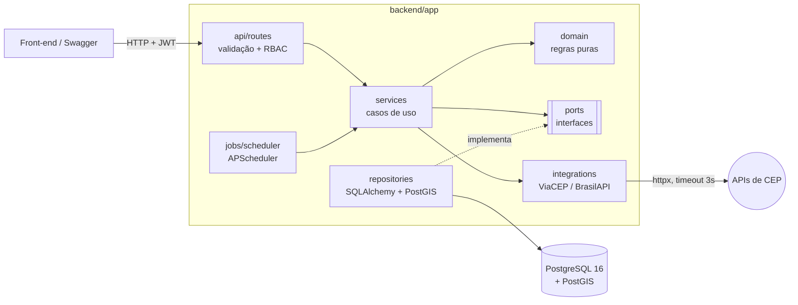
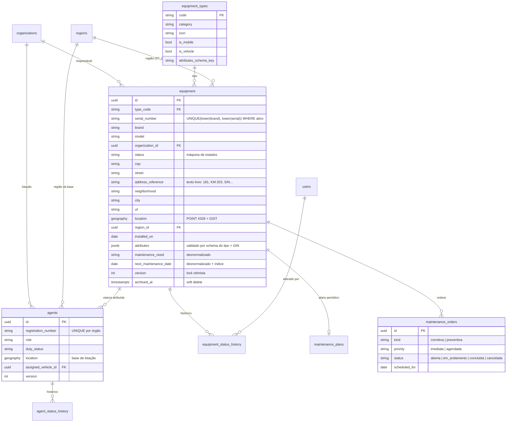
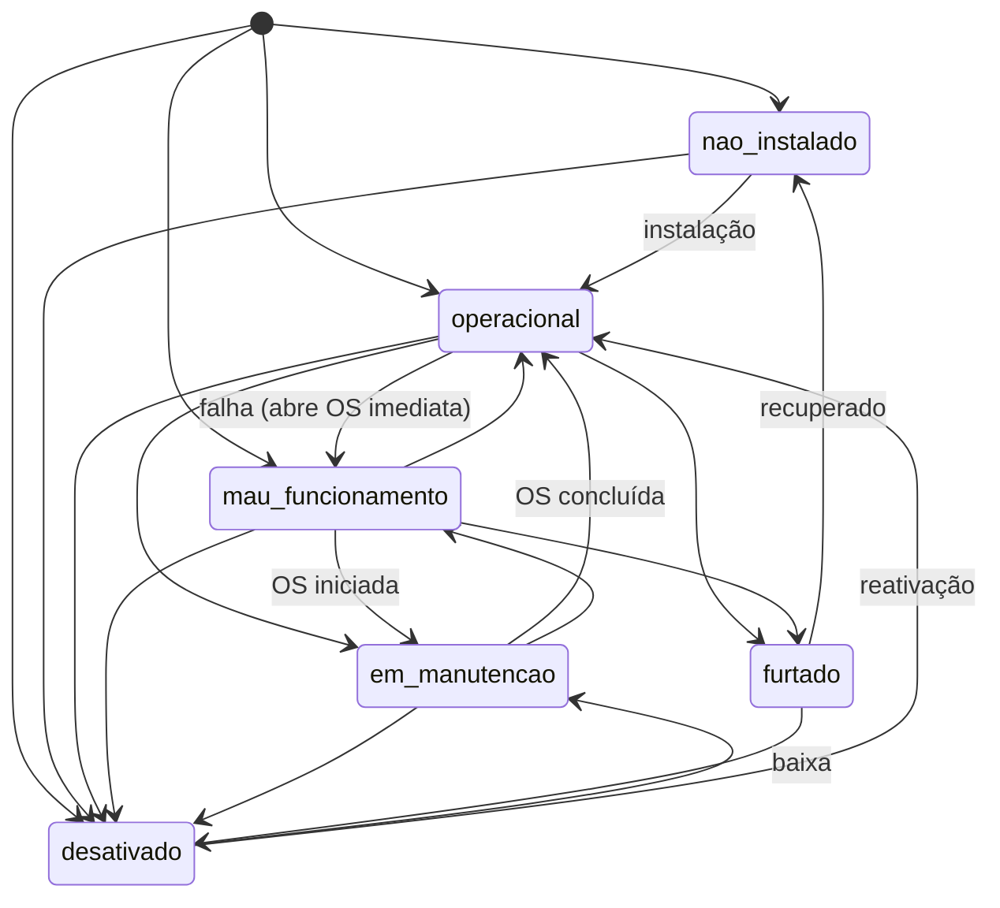
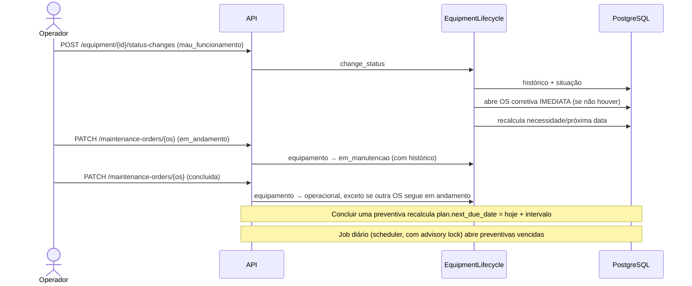
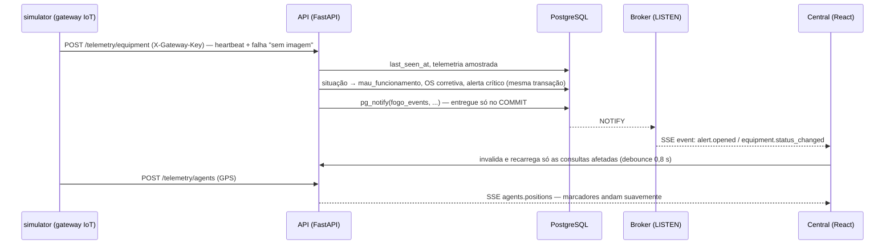
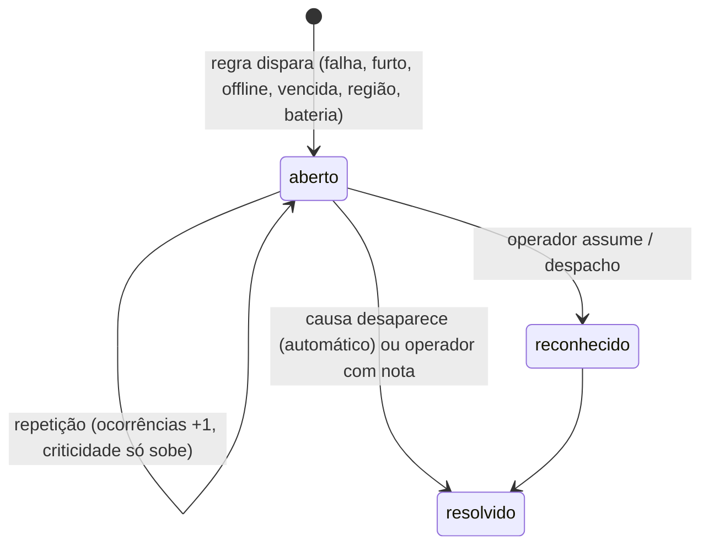
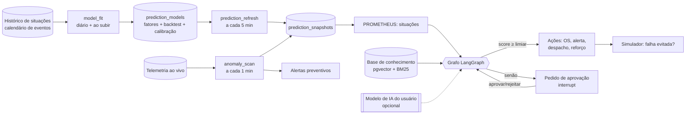
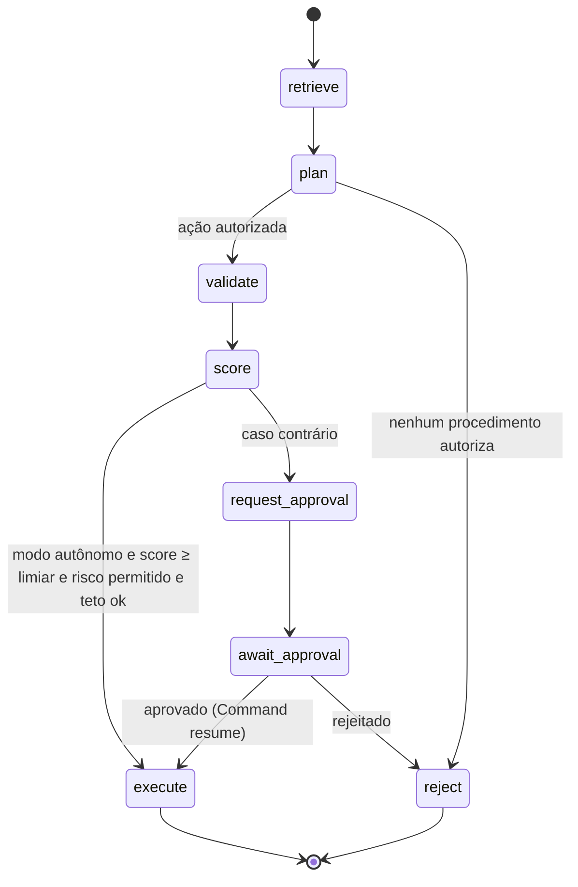

# Arquitetura — F.O.G.O.

## Visão geral



- **Rotas** só convertem HTTP ↔ contratos Pydantic e declaram a permissão exigida (`Requires(Permission.X)`).
- **Serviços** orquestram uma operação inteira dentro de **uma** unidade de trabalho (`async with uow` → `commit`). Qualquer exceção leva a rollback.
- **Domínio** não conhece banco nem HTTP: máquina de estados, política de manutenção e regras de agentes são funções puras, testadas exaustivamente.
- **Repositórios** são o único lugar com SQL. Eles convertem as linhas em objetos de domínio (Data Mapper), e os serviços dependem só das **portas** (`services/ports.py`). Por isso os testes unitários usam repositórios em memória.
- **Integrações** externas ficam isoladas: o serviço de endereço recebe uma lista de provedores e tenta um após o outro.
- Nada é criado no import: engine, pool e cliente HTTP nascem no `lifespan` (`create_app()` é uma factory).

## Modelo de dados



Os enums são guardados como `VARCHAR + CHECK`, o que permite evoluir sem `ALTER TYPE`. Todas as datas usam `timestamptz`, e as datas de calendário (`installed_on`, vencimentos) seguem o fuso `America/Sao_Paulo`.

## Máquina de estados do equipamento



Uma transição fora do diagrama retorna `409 transicao_de_situacao_invalida` com a lista `allowed_transitions`. As saídas de `[*]` representam as situações aceitas no cadastro inicial.

## Fluxo de manutenção (automações)



Todos os passos de uma mesma requisição acontecem na **mesma transação**.

## Segurança e autorização

| Permissão | consulta | operador | gestor | admin |
|---|:-:|:-:|:-:|:-:|
| ler equipamentos, agentes e órgãos | ✅ | ✅ | ✅ | ✅ |
| mudar situação de equipamento ou agente | | ✅ | ✅ | ✅ |
| operar ordens de manutenção | | ✅ | ✅ | ✅ |
| cadastrar/editar/excluir equipamentos e agentes | | | ✅ | ✅ |
| planos de manutenção, órgãos e tipos | | | ✅ | ✅ |
| gerenciar usuários | | | | ✅ |

A matriz fica em `app/core/permissions.py`, e as rotas declaram a **permissão**, nunca o perfil.

## Observabilidade

- Logs em JSON (`timestamp`, `level`, `logger`, `message`, `request_id` e campos de contexto), sem dados sensíveis.
- Cada resposta devolve `X-Request-ID`, que também aparece nos logs e no corpo dos erros.
- `GET /health` (liveness) e `GET /health/ready` (testa o banco), usados pelos healthchecks do compose.
- Timeouts explícitos:
  - HTTP: 3 s;
  - conexão com o banco: 5 s;
  - `statement_timeout` de 15 s no servidor;
  - pool com `pool_timeout` e `pool_pre_ping`.

---

# Parte 2 — Central de Operações

## Fluxo em tempo real



- **Transacional**: se o caso de uso falhar, o NOTIFY não é entregue, então não há evento "fantasma" no painel.
- **Fan-out**: uma conexão `LISTEN` dedicada por processo da API, com uma fila limitada por cliente. Um cliente lento recebe `resync` e recarrega o snapshot, sem derrubar ninguém.
- **Front**:
  - posições de agentes vão direto ao cache (sem nova requisição);
  - os demais eventos invalidam só as consultas afetadas (`staleQueriesFor`, testado);
  - o SSE reconecta com backoff e pausa com a aba oculta.

## Alertas



| Tipo | Origem | Criticidade |
|---|---|---|
| Falha de equipamento | mudança para *mau funcionamento* (manual ou autodetectada pelo dispositivo) | por tipo (semáforo = crítica), +1 no Centro |
| Furto | mudança para *furtado* | crítica para viatura, moto e câmera; senão alta |
| Sem comunicação | job: sem heartbeat há mais de 5 min (só de quem deveria transmitir) | um nível abaixo da falha |
| Manutenção vencida | job: próxima data já passou | média (equipamento crítico) ou baixa |
| Região degradada | job: índice de saúde abaixo de 85 | alta (crítico) ou média (atenção), acompanha o estado |
| Bateria baixa | telemetria abaixo de 15% (histerese até 25%) | baixa |

SLA: crítica 1 h · alta 4 h · média 24 h · baixa 72 h. `sla_breached` é calculado na leitura.

## Índice de saúde da região

```
nota = 100 × disponibilidade
     − min(40, Σ peso(alertas sem dono) + 0,25 × Σ peso(alertas reconhecidos))   peso: crítica 8, alta 4, média 1,5, baixa 0,5
     − 30 × fração offline − 20 × fração com reparo imediato
nível: ≥ 85 normal · ≥ 70 atenção · < 70 crítico   (+ lista de motivos legíveis)
```

## Despacho inteligente

1. **Elegibilidade**: furto → GCM/PM; equipamento de trânsito → agente de trânsito ou GCM; demais → GCM, trânsito ou PM. Só entra quem está em turno e livre.
2. **Busca**: KNN `ORDER BY coalesce(posição_gps, base) <-> alvo` no PostGIS, com distância em metros (`ST_Distance` em `geography`).
3. **Ranking por ETA**: distância × 1,3 ÷ velocidade (viatura 35, moto 40, a pé 5 km/h).
4. **Despachar** cria o despacho (no máximo um ativo por agente, garantido por índice único parcial), muda o agente para *em ocorrência* com histórico e reconhece o alerta.
5. O **GPS** move a equipe. O backend detecta a saída (mais de 25 m da origem) e a chegada (geofence de 60 m), e o operador conclui o atendimento.

## Simulador (só dispositivos e GPS)

- **Equipamentos**:
  - heartbeat a cada ~30 s com sinal, temperatura (ciclo diário) e bateria (patinetes e veículos autônomos);
  - quedas de conectividade mais frequentes à noite e nas regiões de maior risco;
  - uma falha autodetectada a cada ~3 min, ponderada por tipo e região.
- **Agentes**: em patrulha fazem passeio aleatório dentro da cidade; despachados seguem até o alvo; fora de turno ficam na base.
- **Não toma decisões humanas** (reparos, despachos): essas ficam com o operador. A operação autônoma do PROMETHEUS fica para a Parte 3.


# Parte 3 — Cidade Preditiva e PROMETHEUS

## Visão geral



## Motor preditivo (`app/domain/prediction/`, puro + numpy)

| Módulo | O que prevê | Método |
|---|---|---|
| `risk_model.py` | ocorrências por região × hora (7 dias) | Poisson multiplicativo, *raking* (IPF), encolhimento empirical Bayes, exposição em equipamento-dias operacionais |
| `backtest.py` | quão bom é o modelo | treino sem as últimas 8 semanas; desvio de Poisson e MAE contra média histórica e perfil por hora; cobertura top-20%; calibração isotônica simples |
| `equipment_risk.py` | chance de falha em 72 h por equipamento | taxa do tipo × tendência × região × preventiva vencida × perfil das próximas 72 h |
| `anomaly.py` | falha iminente e picos regionais | z robusto (mediana/MAD) por equipamento; teste binomial exato de participação regional |
| `reinforcement.py` | efetivo por região e faixa | proporcional ao risco, piso de 8%, mínimo por público de eventos |
| `trends.py` | tendência de disponibilidade | Theil–Sen + projeção do cruzamento de 90% |
| `precursor_model.py` | se um aviso de falha iminente é falha real | regressão logística (IRLS + L2) retreinada a cada desfecho; avaliação temporal (AUC, Brier, precisão × regra) |

O seed e o simulador geram os dados com padrões documentados (`app/seed/city_patterns.py`). Um teste garante que o motor preditivo não importa esses parâmetros: ele aprende só do histórico.

## PROMETHEUS (`app/agent/`)



- **Situações:** `situations.py` transforma retratos e anomalias em situações com `confidence` medida.
- **Checkpointer:** `AsyncPostgresSaver`. O scheduler roda os ciclos; a API retoma o grafo pausado.
- **Ferramentas:** `actions.py`, sempre por meio dos serviços existentes, com o usuário de sistema PROMETHEUS.
- **Chat:** `chat.py`, um agente ReAct (`create_react_agent`) com ferramentas **só de leitura**. A resposta sai em streaming por SSE.

## Base de conhecimento (RAG híbrido)

1. **Ingestão:** arquivos `backend/knowledge/*.md` no bootstrap ou documentos criados na tela. A ingestão é idempotente pelo hash do conteúdo.
2. **Trechos:** um por título, cada um com:
   - lexemas em português, para o BM25;
   - vetor local de 384 dimensões;
   - vetor do provedor (768 dimensões), se configurado.
3. **Busca:** BM25 + cosseno (pgvector HNSW), fundidos por RRF (k = 60).
4. **Autorização:** só trechos de procedimentos com evidência ≥ 0,25 (e tipo e região compatíveis) autorizam ações.

## Modelo de IA do usuário (`app/ai/`)

- **Gateway** (`gateway.py`): o único ponto que chama o LLM. Ele cuida de:
  - configuração e limites diários;
  - disjuntor;
  - saída estruturada (Pydantic);
  - registro de tokens e custo em `ai_usage`.
- **Provedores** (`providers.py`): `ChatOpenAI`, `ChatAnthropic` e `ChatGoogleGenerativeAI`, além do modo compatível com OpenAI por `base_url`. Os erros são traduzidos em mensagens acionáveis.
- **Chave** (`crypto.py`): Fernet com `AI_ENCRYPTION_KEY`; só de escrita.


## Guardrails (`app/domain/guardrails.py`)

Injeção de prompt, segredos e dados pessoais são verificados nos documentos (recusa, com o que foi encontrado) e no chat (mascaramento de dados pessoais, recusa de injeção, limite de perguntas). Documentos da tela autorizam no máximo ações de risco médio. Detalhes na ADR-026.
