# Manual do usuário

Este manual explica como usar o F.O.G.O. no dia a dia da Central de Operações de Marília: acompanhar a cidade ao vivo, tratar alertas, despachar equipes, ler as previsões e trabalhar com o PROMETHEUS, o agente que age antes de o problema acontecer.

Dentro do sistema, o manual abre pelo ícone **?** da barra superior.

<!-- sumario -->
## Sumário

1. [Primeiros passos](#1-primeiros-passos)
2. [Central de Operações](#2-central-de-operações)
3. [Previsões](#3-previsões)
4. [PROMETHEUS](#4-prometheus)
5. [Pergunte ao PROMETHEUS](#5-pergunte-ao-prometheus)
6. [Equipamentos](#6-equipamentos)
7. [Agentes](#7-agentes)
8. [Administração](#8-administração)
9. [Perguntas frequentes](#9-perguntas-frequentes)
10. [Glossário](#10-glossário)
<!-- /sumario -->

## 1. Primeiros passos

### Entrar no sistema

Abra o endereço do sistema no navegador (na instalação local, `http://localhost:8080`) e informe e-mail e senha.

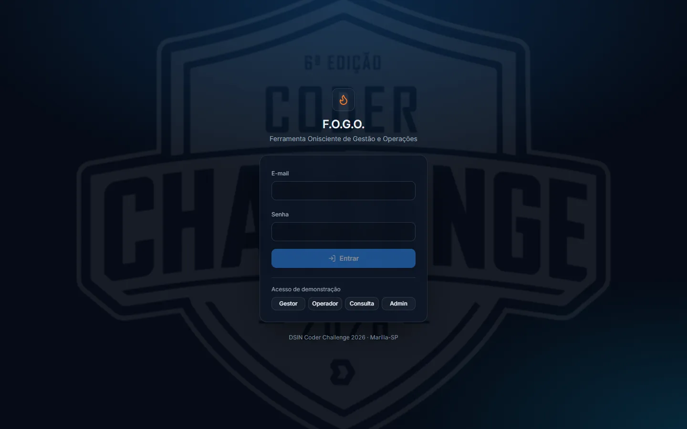

Na demonstração, os botões **Gestor**, **Operador**, **Consulta** e **Admin** entram direto com o usuário de cada perfil. Todos usam a senha `Fogo@2026`:

| Perfil | E-mail |
|---|---|
| Administrador | `admin@fogo.dev` |
| Gestor | `gestor@fogo.dev` |
| Operador | `operador@fogo.dev` |
| Consulta | `consulta@fogo.dev` |

A sessão dura 8 horas, um turno de trabalho (o prazo é configurável na instalação). Depois disso, o sistema volta para a tela de entrada e basta entrar de novo.

### Perfis de acesso

Cada usuário tem um perfil. O que não está liberado para o seu perfil não aparece na tela (e o servidor confere de novo a cada ação).

| O que dá para fazer | Consulta | Operador | Gestor | Admin |
|---|:-:|:-:|:-:|:-:|
| Ver a Central, as Previsões, os equipamentos e os agentes | ✓ | ✓ | ✓ | ✓ |
| Reconhecer alertas e despachar equipes | | ✓ | ✓ | ✓ |
| Mudar a situação de um equipamento e operar ordens de manutenção | | ✓ | ✓ | ✓ |
| Aprovar ou rejeitar pedidos do PROMETHEUS | | ✓ | ✓ | ✓ |
| Cadastrar, editar e excluir equipamentos e agentes | | | ✓ | ✓ |
| Cadastrar órgãos responsáveis | | | ✓ | ✓ |
| Ajustar a autonomia do PROMETHEUS e a base de conhecimento | | | ✓ | ✓ |
| Gerenciar usuários e configurar o modelo de IA | | | | ✓ |

### A barra superior

A barra do topo fica visível em todas as telas:

- **Central de Operações**, **Previsões**, **Equipamentos**, **Agentes** e **Administração** levam às telas principais. Administração só aparece para Gestor e Admin.
- **?** abre este manual.
- **Ao vivo** mostra se o sistema está recebendo os eventos da cidade em tempo real. Amarelo significa conectando; vermelho, sem conexão (o sistema tenta de novo sozinho).
- O **sino** liga ou desliga o aviso sonoro de alertas críticos.
- O **balão** abre o [Pergunte ao PROMETHEUS](#5-pergunte-ao-prometheus).
- O **sol/lua** alterna entre tema claro e escuro.
- O **seu nome** abre o menu com a opção **Sair**.

## 2. Central de Operações

É a tela inicial: o mapa de Marília com todos os equipamentos e agentes, atualizado ao vivo.

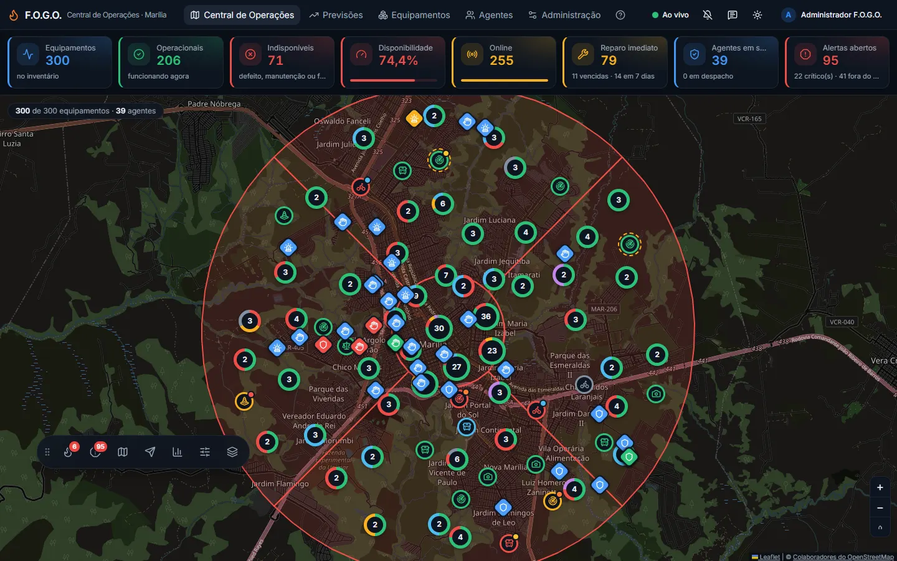

### Indicadores do topo

Os cartões do topo resumem a cidade agora: total de equipamentos, operacionais, indisponíveis, disponibilidade, online, reparo imediato, agentes em serviço e alertas abertos.

Clique em um cartão para filtrar o mapa por ele. Por exemplo, **Indisponíveis** deixa no mapa só o que está com defeito, em manutenção ou furtado. Clique de novo para tirar o filtro.

### O mapa

- Cada ícone é um equipamento. A cor da borda indica a situação: verde operacional, vermelho mau funcionamento, amarelo em manutenção, roxo furtado.
- Três marcas chamam atenção: o **halo pulsante** indica reparo imediato, o **anel tracejado** indica manutenção vencida ou vencendo em até 7 dias e o ícone **esmaecido** indica um equipamento sem comunicação.
- Os círculos com número agrupam equipamentos próximos. Aproxime o mapa (roda do mouse ou **+**) para separá-los. A borda colorida mostra a proporção de cada situação no grupo.
- Os ícones azuis em losango são agentes em campo, na posição do GPS.
- As cores de fundo mostram a saúde de cada região (Centro e Zonas Norte, Sul, Leste e Oeste).
- O botão **⌂**, no canto inferior direito, volta a mostrar a cidade inteira.

### A barra de ferramentas

A barra flutuante no canto inferior abre os painéis da Central. O nome de cada botão aparece ao passar o mouse, e a barra pode ser arrastada pela alça pontilhada.

| Botão | Abre |
|---|---|
| PROMETHEUS (chama) | Painel do [PROMETHEUS](#4-prometheus). O número é a quantidade de pedidos de aprovação pendentes. |
| Alertas | Lista de alertas abertos. O número é o total. |
| Regiões | Regiões, da pior para a melhor |
| Equipes | Despachos em andamento |
| Análises | Falhas × reparos e situação por tipo |
| Filtros | Filtros do mapa |
| Camadas | Estilo do mapa, camadas e legenda |

### Tratar um alerta

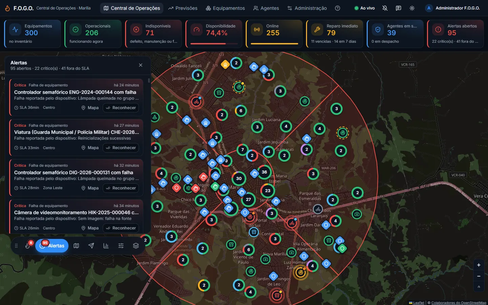

1. Abra **Alertas** na barra de ferramentas. Os mais graves aparecem primeiro e, dentro de cada gravidade, os mais recentes.
2. Cada cartão mostra a criticidade, o tipo, o equipamento, a região e o **SLA**, que é o tempo que resta para tratar o alerta. Os prazos são de 1 h para crítico, 4 h para alta, 24 h para média e 72 h para baixa.
3. **Mapa** leva até o equipamento e abre o detalhe dele.
4. **Reconhecer** registra que alguém da Central já está cuidando do caso. O alerta continua aberto até o problema ser resolvido.

Os alertas de falha fecham sozinhos quando o equipamento volta a operar. Os de comunicação fecham quando o equipamento volta a se comunicar.

### Ver o detalhe de um equipamento

Clique em um equipamento no mapa, ou em **Mapa** num alerta, para abrir o painel lateral.

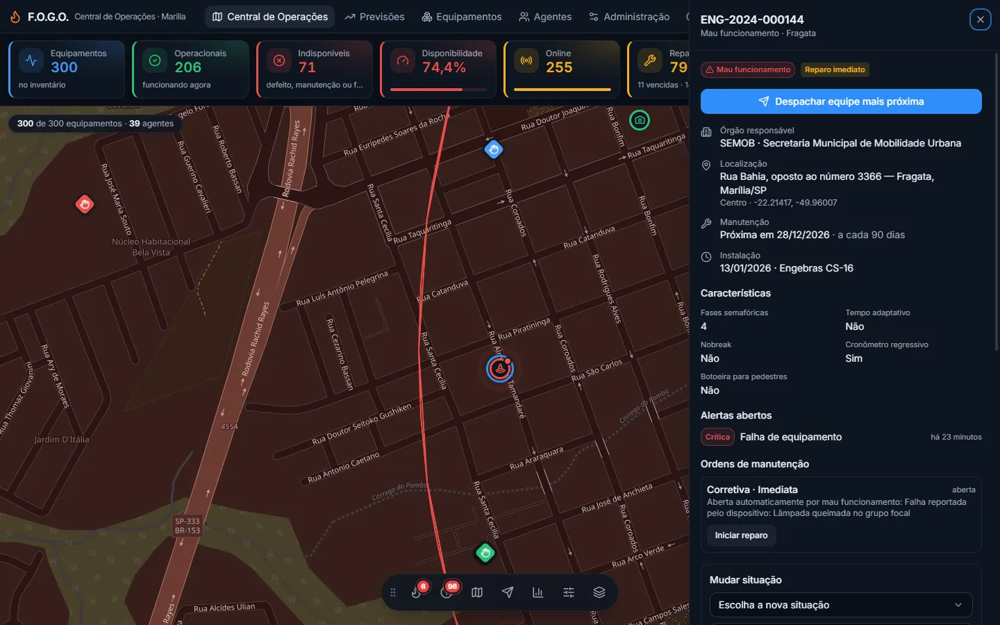

O painel mostra a situação, o órgão responsável, o endereço, a próxima manutenção, as características do equipamento, os alertas abertos, as ordens de manutenção e o histórico de mudanças.

### Despachar uma equipe

1. No detalhe do equipamento, clique em **Despachar equipe mais próxima**.
2. A lista mostra só os agentes livres e aptos para aquele tipo de ocorrência, ordenados pelo tempo estimado de chegada. O primeiro vem marcado como **recomendado**.
3. Escolha o agente e clique em **Despachar agora**.

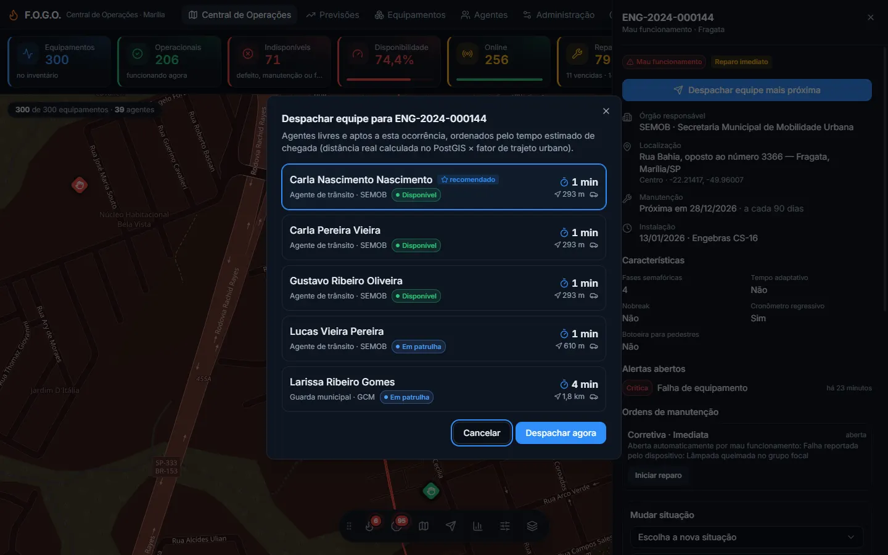

Quando o GPS do agente chega ao local, o despacho passa sozinho para **no local**. Depois, use **Concluir atendimento** no detalhe do equipamento. Se precisar desfazer, use **Cancelar despacho**. As equipes em deslocamento aparecem no painel do avião de papel.

### Ordens de manutenção

Quando um equipamento entra em mau funcionamento, o sistema abre uma ordem de manutenção corretiva automaticamente. No detalhe do equipamento:

1. **Iniciar reparo** coloca o equipamento em manutenção.
2. **Concluir reparo** devolve o equipamento à operação e fecha a ordem.

As preventivas são abertas pelo sistema conforme o plano de manutenção de cada equipamento, ou pelo PROMETHEUS quando ele prevê uma falha.

### Mudar a situação de um equipamento

No fim do detalhe, em **Mudar situação**, escolha a nova situação, escreva o motivo e clique em **Registrar mudança**. Só aparecem as mudanças permitidas a partir da situação atual. Toda mudança fica no histórico, com quem fez e quando.

### Camadas e risco previsto

Em **Camadas** você escolhe o estilo do mapa (automático, claro, escuro ou satélite) e liga ou desliga:

- **Equipamentos** e **Agentes ao vivo**;
- **Saúde das regiões**;
- **Calor de falhas (90 dias)**, onde as falhas mais se concentraram;
- **Risco previsto (próximas 24 h)**, que mostra onde o modelo espera mais ocorrências.

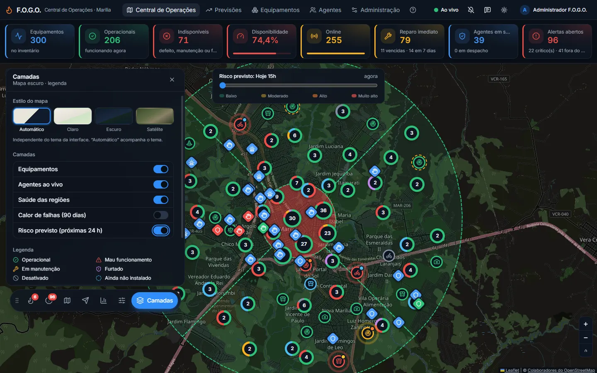

Com o risco previsto ligado, aparece no topo do mapa um controle deslizante. Arraste-o para ver o risco hora a hora nas próximas 24 h.

### Regiões, equipes e análises

- **Regiões** lista as cinco regiões da pior para a melhor, com nota de saúde, disponibilidade, equipamentos fora e agentes. Clique numa região para filtrar o mapa.
- **Equipes** mostra os despachos em andamento.
- **Análises** traz o gráfico de falhas × reparos dos últimos 14 dias, com o tempo médio de reparo, e a situação por tipo de equipamento.

### Filtros

Em **Filtros** você combina situação, manutenção, comunicação, tipo de equipamento, região e órgão responsável. O total no canto superior esquerdo do mapa mostra quantos equipamentos sobraram. **Limpar** remove todos os filtros.

## 3. Previsões

A tela **Previsões** (Cidade Preditiva) mostra o que tende a acontecer, por que, e onde agir antes. As previsões são recalculadas a cada 5 minutos com o histórico de um ano e os dados ao vivo. Elas funcionam sem modelo de IA.

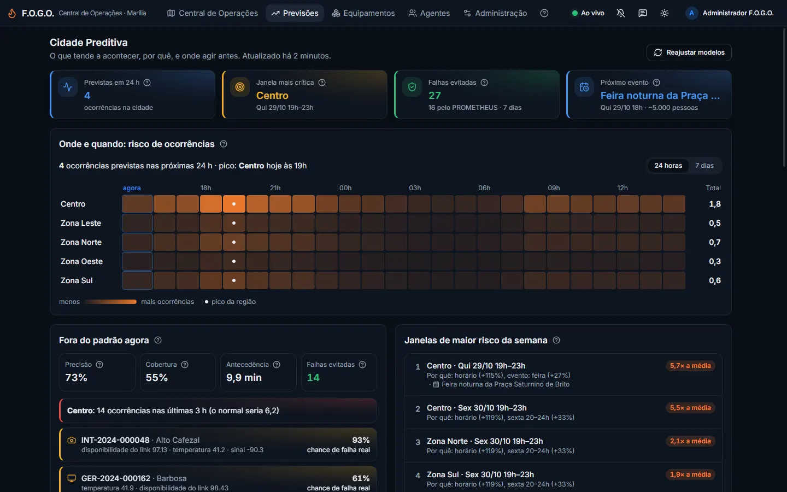

### Resumo

O topo mostra as ocorrências previstas para 24 h, a janela mais crítica, as falhas evitadas e o próximo evento da cidade (jogos, shows, feiras), que costuma mudar o risco.

### Onde e quando: risco de ocorrências

Uma tabela de regiões × horas, nas próximas 24 h ou 7 dias. Quanto mais forte a cor, mais ocorrências esperadas. Passe o mouse numa célula para ver o valor e os fatores que pesaram (horário, dia da semana, estação, eventos, região).

### Fora do padrão agora

Equipamentos cuja telemetria saiu do normal (temperatura, sinal, disponibilidade do link), com a chance de ser uma falha real. Mostra também regiões com mais ocorrências do que o esperado nas últimas 3 h. A precisão, a cobertura e a antecedência média aparecem no topo do cartão.

### Onde posicionar o efetivo

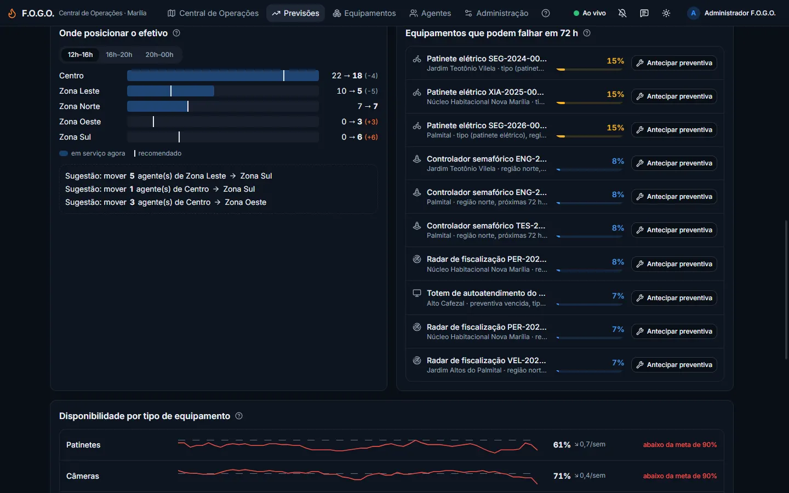

Para cada faixa de 4 h, compara os agentes em serviço com os recomendados para cada região e sugere remanejamentos ("mover 5 agentes da Zona Leste para a Zona Sul").

### Equipamentos que podem falhar em 72 h

Os equipamentos com maior chance de falhar nos próximos 3 dias, com os motivos. **Antecipar preventiva** abre uma ordem de manutenção preventiva na hora (Operador, Gestor e Admin).

Em todas as seções, o ícone **ⓘ** ao lado do título explica o que a previsão mostra, quais dados ela usa e como ajuda a decidir.

### Disponibilidade por tipo de equipamento

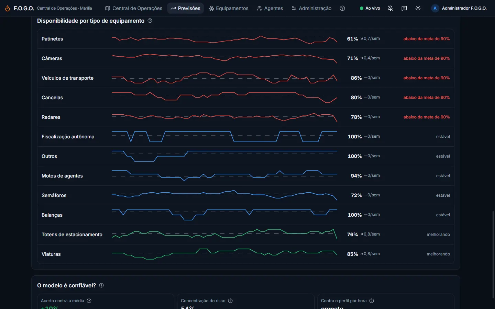

A evolução da disponibilidade de cada tipo, a tendência por semana e se ele está abaixo da meta de 90%.

### O modelo é confiável?

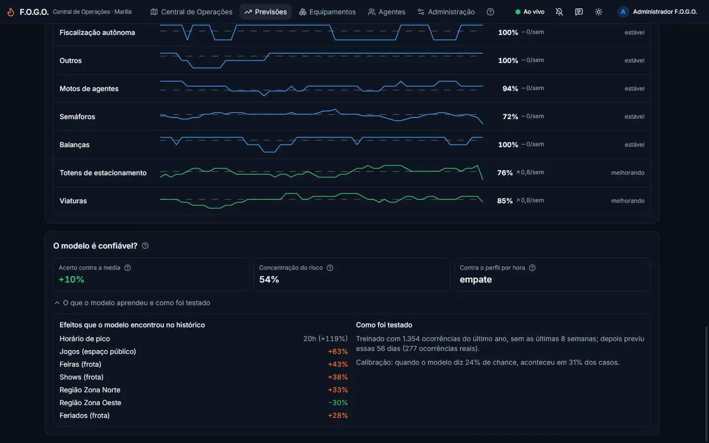

O modelo é treinado com o último ano sem as 8 semanas mais recentes e depois precisa prever essas 8 semanas, que ele não viu. O resultado é comparado com previsões simples (a média e o perfil por hora). Se o modelo não for melhor que elas, a tela mostra "empate" ou o número negativo, sem esconder.

Em **O que o modelo aprendeu e como foi testado** ficam os efeitos que ele encontrou no histórico (horário de pico, jogos, feiras, feriados, regiões) e a calibração: quando ele diz 24% de chance, quantas vezes aquilo de fato aconteceu.

**Reajustar modelos** (Gestor e Admin) treina de novo com os dados mais recentes.

## 4. PROMETHEUS

O PROMETHEUS é o agente que vigia a cidade a cada minuto. Quando vê um sinal de falha iminente, um equipamento com alto risco, um pico fora do padrão ou falta de efetivo, ele consulta a base de procedimentos e decide:

- **age sozinho** quando a política de autonomia permite (por exemplo, abrir uma ordem preventiva para um semáforo que está esquentando);
- **pede aprovação** quando a confiança é baixa, a ação é arriscada ou o teto de ações automáticas por hora foi atingido.

Ações de risco alto, como remanejar agentes, sempre pedem aprovação.

### O painel

Abra pela chama na barra de ferramentas da Central. O número na chama é a quantidade de pedidos esperando decisão.

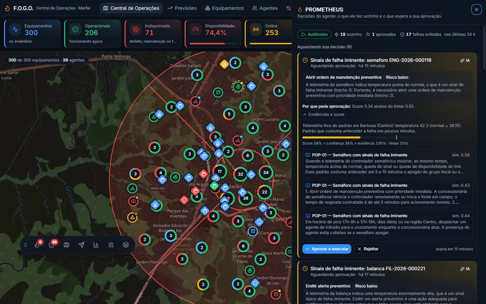

No topo ficam o modo de operação, as ações tomadas sozinho, as aprovadas e as **falhas evitadas** nas últimas 24 h. Uma falha evitada é um equipamento que recebeu intervenção antes da hora em que ia falhar.

### Aprovar ou rejeitar um pedido

1. Em **Aguardando sua decisão**, leia a ação proposta, a justificativa e o motivo do pedido.
2. **Evidências e score** mostra a telemetria que disparou a decisão, o cálculo do score (confiança × evidência, contra o limiar da ação) e os trechos dos procedimentos que a autorizam.
3. **Aprovar e executar** realiza a ação em nome do PROMETHEUS, registrando quem aprovou.
4. **Rejeitar** pede um motivo opcional, que fica registrado.

Cada pedido expira em 30 minutos (o prazo pode ser ajustado em Administração › Autonomia). Pedidos expirados são descartados.

O selo **IA** indica que a ação e a justificativa foram escritas pelo modelo de IA. Sem esse selo, o PROMETHEUS usou as regras dos procedimentos. Nos dois casos, quem decide se ele age sozinho é a política de autonomia, nunca o modelo.

### Atividade recente

Abaixo dos pedidos fica o histórico: o que foi executado sozinho, aprovado, rejeitado, expirado ou ficou sem ação (quando nenhum procedimento autoriza agir).

## 5. Pergunte ao PROMETHEUS

Pelo **balão** da barra superior, você conversa com o PROMETHEUS em português. Ele responde com as previsões, a base de conhecimento e as decisões registradas, e diz o que consultou.

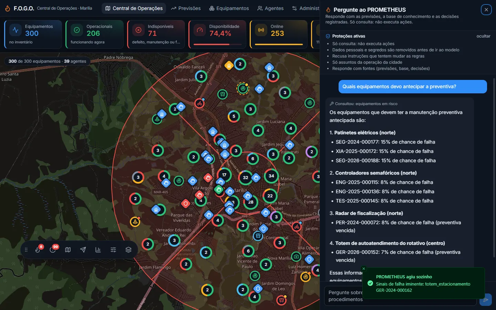

Bons exemplos de pergunta:

- "Onde reforçar o efetivo hoje à noite?"
- "Quais equipamentos devo antecipar a preventiva?"
- "Há algo fora do padrão na cidade agora?"
- "O que diz o procedimento para semáforo com sinais de falha?"

O chat só consulta: ele não executa nenhuma ação. Também não responde sobre assuntos fora da operação da cidade, recusa instruções que tentem mudar suas regras e remove dados pessoais (como CPF) antes de enviar a pergunta ao modelo. Clique em **Proteções ativas** para ver a lista.

O chat precisa de um modelo de IA configurado pelo administrador. Sem ele, aparece um aviso, e o restante do sistema continua funcionando normalmente.

## 6. Equipamentos

O inventário lista todos os equipamentos da cidade: semáforos, câmeras, radares, totens, cancelas, balanças, patinetes, viaturas, motos e veículos.

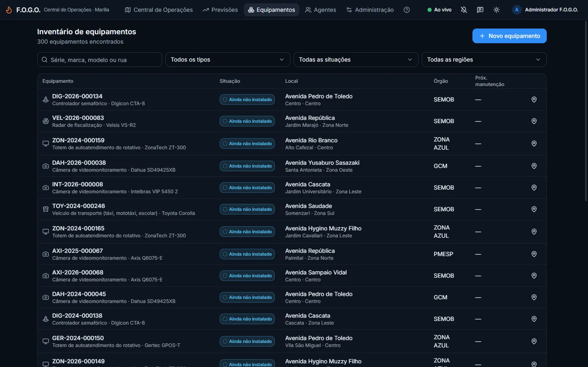

- Busque por série, marca, modelo ou rua, ou filtre por tipo, situação e região.
- O ícone de alfinete mostra o equipamento no mapa da Central.
- Clique na linha para abrir o cadastro.

### Cadastrar ou editar (Gestor e Admin)

1. Clique em **Novo equipamento** ou numa linha da lista.
2. Em **Identificação**, escolha o tipo, informe o número de série, o órgão responsável, a marca, o modelo e a data de instalação.
3. Em **Localização**, digite o CEP e clique em **Buscar CEP** para preencher o endereço. Depois clique no mapa para marcar o ponto exato. Para equipamentos móveis, marque a base.
4. Em **Características**, preencha os campos do tipo escolhido (por exemplo, resolução e visão noturna para câmeras). Os campos com * são obrigatórios.
5. Clique em **Salvar**.

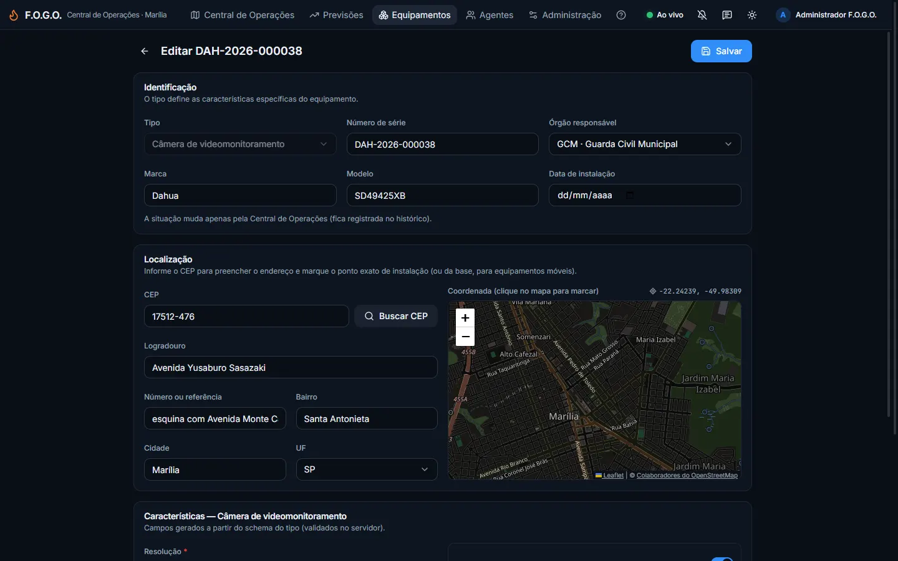

A situação de um equipamento já cadastrado não muda por aqui: ela muda pela Central de Operações, para que fique registrada no histórico.

## 7. Agentes

A lista mostra os agentes de campo (agentes de trânsito, guardas municipais, policiais militares), com situação, órgão, viatura e região da base. Filtre por órgão ou por quem está em serviço.

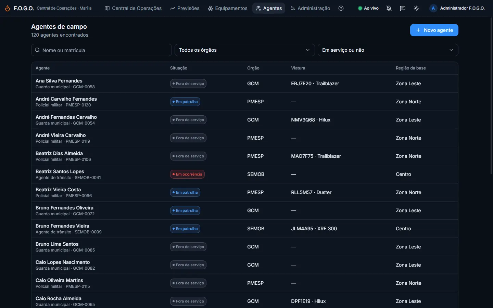

Para cadastrar (Gestor e Admin), use **Novo agente**. Informe nome, matrícula, órgão, cargo, viatura ou moto (opcional) e a base de lotação com CEP e ponto no mapa.

O sistema guarda só os dados necessários à operação. CPF, telefone e endereço pessoal não são pedidos, conforme a LGPD.

## 8. Administração

Disponível para Gestor e Admin. Cada aba aparece conforme o perfil.

### Usuários (Admin)

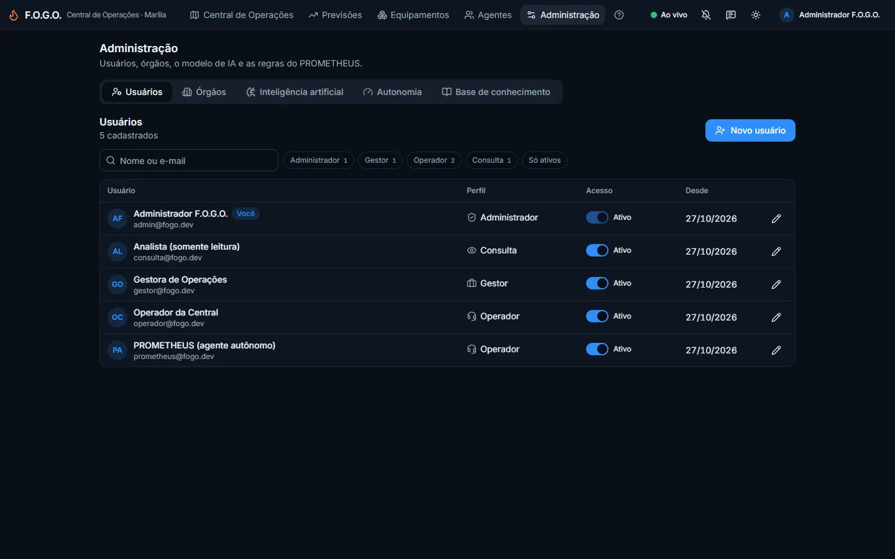

- **Novo usuário** cria um acesso com nome, e-mail, perfil e uma senha provisória de pelo menos 8 caracteres. O botão de copiar ajuda a enviá-la à pessoa por um canal seguro.
- Na linha de cada usuário, o lápis edita nome, perfil ou senha, e a chave liga ou desliga o acesso. Um usuário desativado não consegue entrar, mas o histórico dele é mantido. Ninguém desativa o próprio acesso.
- A busca e os filtros por perfil ajudam a achar alguém.
- O usuário **PROMETHEUS (agente autônomo)** é do sistema: é ele que assina as ações automáticas. Ele não entra pela tela de login.

### Órgãos

Os órgãos responsáveis (SEMOB, GCM, PMESP, concessionárias...) respondem pelos equipamentos e lotam os agentes. Use **Novo órgão** para cadastrar (nome, sigla e categoria) e o lápis para editar. Cada cartão mostra quantos equipamentos e agentes o órgão tem.

### Inteligência artificial (Admin)

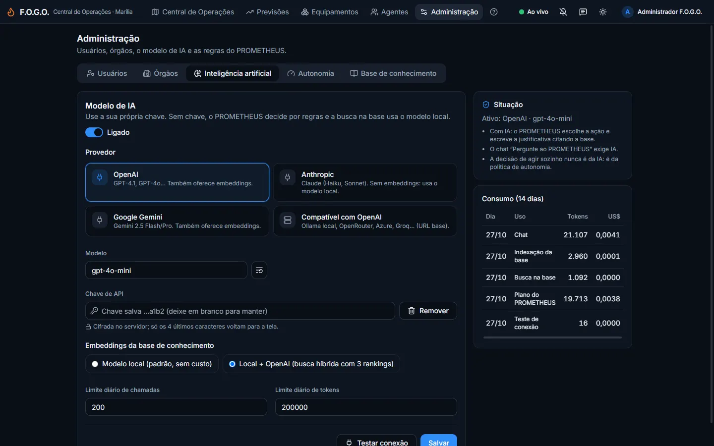

O sistema funciona inteiro sem IA. Com uma chave de um provedor (OpenAI, Anthropic, Google Gemini ou um servidor compatível com OpenAI, como o Ollama), o PROMETHEUS passa a escrever as justificativas citando a base, e o chat é liberado.

1. Ligue **Usar modelo de IA** e escolha o provedor.
2. Cole a **chave de API**. Ela fica cifrada no servidor, e só os 4 últimos caracteres voltam para a tela.
3. Clique no ícone ao lado do modelo para listar os modelos da sua chave (sem custo) e escolha um.
4. Clique em **Testar conexão**. O teste usa poucos tokens.
5. Ajuste os **limites diários** de chamadas e de tokens, que protegem o seu custo.
6. Clique em **Salvar**.

Em **Embeddings**, a opção do provedor soma um terceiro ranking à busca na base de conhecimento. O quadro **Consumo** mostra os tokens e o custo estimado por dia e por uso. **Remover** apaga a chave salva.

### Autonomia (Gestor e Admin)

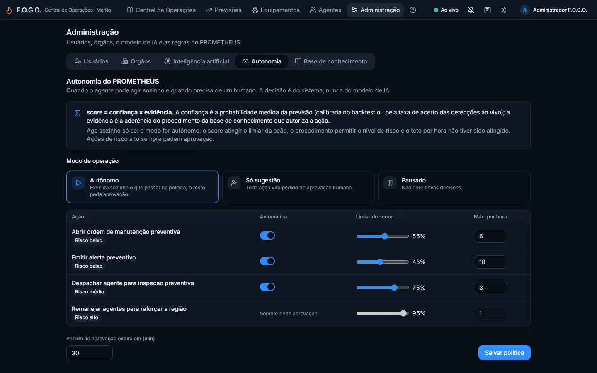

Define quando o PROMETHEUS age sozinho:

- **Modo de operação**: *Autônomo* executa o que passar na política; *Só sugestão* transforma toda ação em pedido de aprovação; *Pausado* não abre novas decisões.
- Para cada ação: se pode ser **automática**, o **limiar do score** e o **máximo por hora**. Remanejar agentes sempre pede aprovação.
- **Pedido de aprovação expira em**: o prazo para alguém decidir.

Clique em **Salvar política** para aplicar.

### Base de conhecimento (Gestor e Admin)

A base reúne os procedimentos que o PROMETHEUS consulta antes de agir: POPs, planos de contingência, protocolos, SLAs, lições aprendidas e a política de autonomia. Cada documento diz em quais situações se aplica, quais ações autoriza e até que nível de risco.

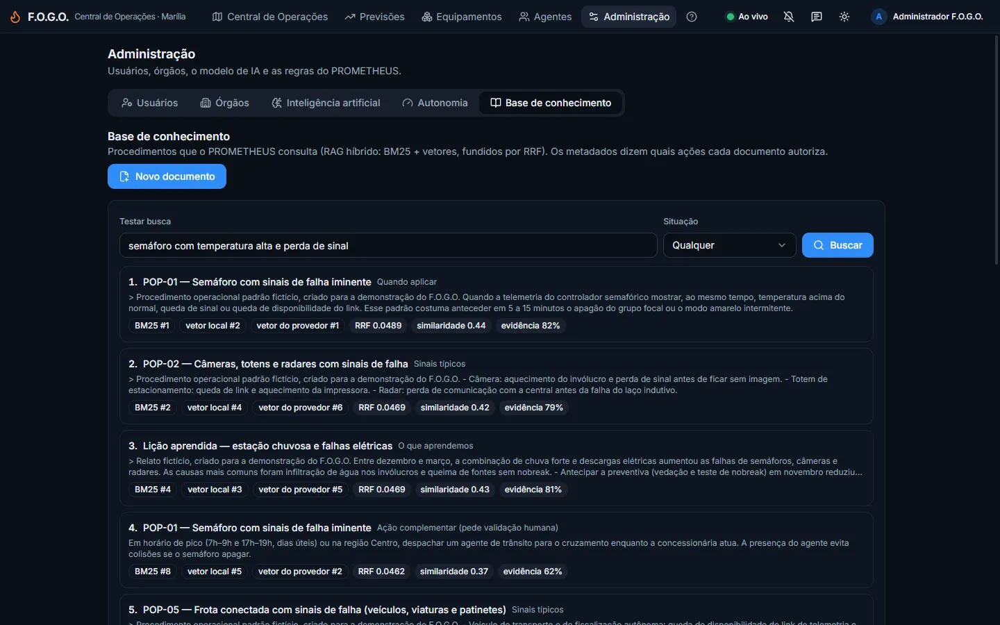

- **Testar busca** mostra o que o PROMETHEUS encontraria para uma pergunta e a posição de cada trecho em cada ranking.
- **Ver trechos** mostra como o documento foi dividido para a busca.
- **Novo documento** e o lápis abrem o editor.

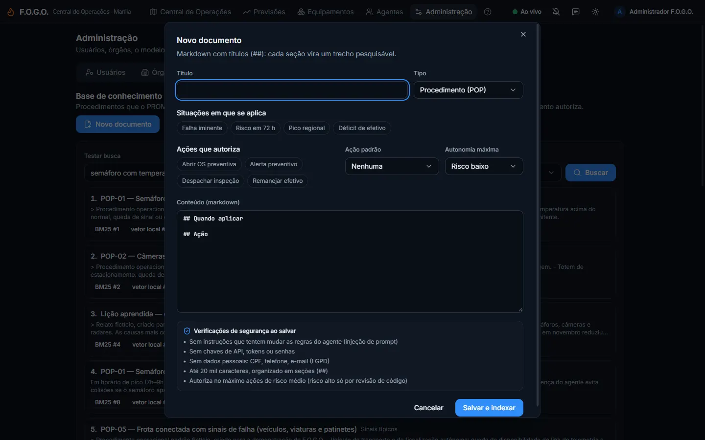

No editor, escreva o conteúdo em markdown, com uma seção `##` para cada assunto, e preencha os metadados. Ao salvar, o sistema recusa documentos com instruções que tentem mudar as regras do agente, com chaves ou senhas, ou com dados pessoais, e mostra o que encontrou. Pela tela, um documento autoriza no máximo ações de risco médio.

Ao excluir um documento que veio dos arquivos do sistema, ele volta na próxima reinicialização.

## 9. Perguntas frequentes

**O PROMETHEUS pode fazer algo perigoso sozinho?**
Não. Ele só escolhe entre as ações que um procedimento da base autoriza, o sistema confere cada ação antes de executar e as de risco alto sempre esperam um humano. O modo **Pausado** desliga novas decisões.

**Por que um pedido de aprovação sumiu?**
Ele expirou (30 minutos por padrão) ou outra pessoa já decidiu. O resultado fica em Atividade recente.

**Por que a lista de despacho veio vazia?**
Não há agente livre e apto para aquele tipo de ocorrência no momento. Veja o painel de equipes ou remaneje o efetivo.

**Preciso de chave de IA?**
Não. Previsões, alertas, despacho e as decisões do PROMETHEUS funcionam sem ela. Só o chat exige um modelo de IA.

**O indicador "Ao vivo" ficou vermelho. E agora?**
A conexão em tempo real caiu. O sistema tenta reconectar sozinho e, ao voltar, recarrega o estado da cidade.

**Fui mandado para a tela de entrada.**
A sessão expirou (8 horas por padrão). Entre de novo.

**Os dados são reais?**
Não. A demonstração simula um ano de operação de Marília-SP e os dispositivos da cidade ao vivo. Nomes, equipamentos e procedimentos são fictícios.

## 10. Glossário

| Termo | Significado |
|---|---|
| Alerta | Aviso de algo que precisa de atenção: falha, furto, falta de comunicação, manutenção vencida, região degradada, risco previsto ou anomalia. |
| SLA | Prazo para tratar um alerta, definido pela criticidade. |
| Despacho | Envio de um agente até um equipamento ou ocorrência. |
| Ordem de manutenção | Pedido de reparo (corretiva) ou de cuidado antecipado (preventiva). |
| Precursor de falha | Sinal na telemetria, como aquecimento ou queda de sinal, que costuma vir minutos antes de uma falha. |
| Falha evitada | Falha prevista que não aconteceu porque o equipamento recebeu intervenção antes. |
| Score | Confiança da previsão × evidência do procedimento. É comparado com o limiar de cada ação. |
| Limiar | Score mínimo para uma ação ser executada sem aprovação. |
| Base de conhecimento | Documentos de procedimento que autorizam e orientam as ações do PROMETHEUS. |
| Telemetria | Dados enviados pelos dispositivos: temperatura, sinal, disponibilidade do link, bateria. |
| Saúde da região | Nota de 0 a 100 que combina disponibilidade, alertas e agentes da região. |
